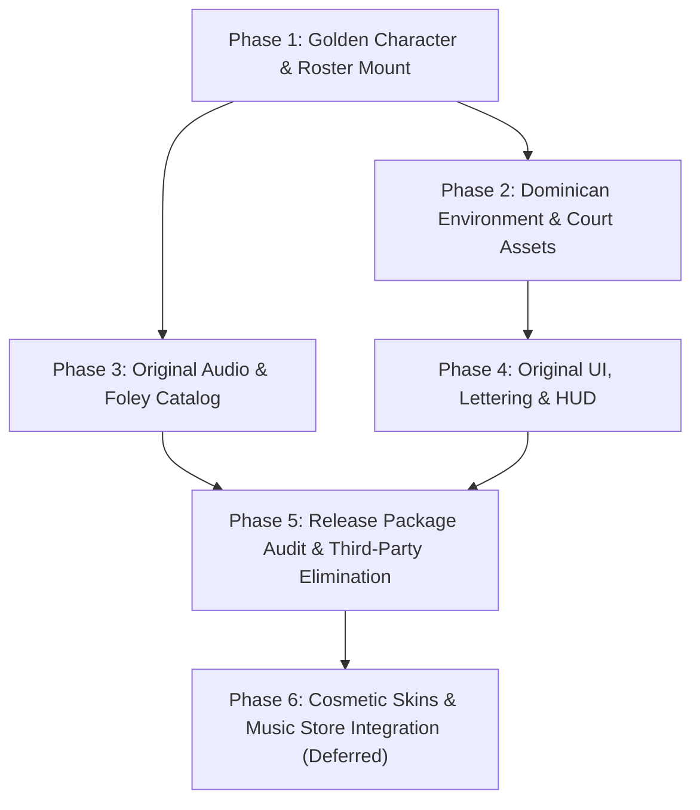

# Northern Step Studio — Street Yun Asset Production Backlog

**Target Milestone:** Street Yun Offline PvE Release (Gate 0 / Issue #18)  
**Commercial Horizon:** Real-Money Cosmetics & Music Store (Issue #19)  
**Governance:** Strict dependency order; Kenney/BigSoundBank fallbacks preserved until replacement passes validation. All visual production follows [Visible Creation Mode](VISIBLE-CREATION-MODE.md).

---

## Verified Current Yun Asset Inventory — October 10, 2026

This is the working source of truth for environment production. Status terms are intentionally strict:

- **MOUNTED / TECH PASS** — loaded by the current Yun runtime and included in the passing export verification.
- **CANDIDATE PASS** — Blender and isolated Godot/gameplay-camera validation passed, but the asset is not mounted in a live Yun map.
- **OWNER REVIEW PENDING** — technical evidence exists, but the visual asset has not been promoted by the owner.
- **TEMPORARY** — Yun still uses a third-party or procedural placeholder.
- **NOT BUILT** — no production candidate exists yet.

### Buildings and storefronts

| Asset group | Current count | Status | Production action |
|---|---:|---|---|
| Building/storefront meshes mounted by `street_kit.gd` | **18 unique** | 17 Kenney placeholders + 1 original colmado | Replace the 17 Kenney meshes without changing gameplay dimensions or camera framing. |
| Residential house meshes in the mounted set | **9 unique Kenney** | **TEMPORARY** | Houses 01 and 02 can replace two slots after owner approval; additional modular residential variants are still required. |
| Commercial/skyline building meshes in the mounted set | **8 unique Kenney** | **TEMPORARY** | Build original shop, garage, corner, narrow commercial, and low-detail background variants. |
| `colmado_storefront.glb` | **1** | **MOUNTED / TECH PASS; OWNER REVIEW PENDING** | Keep as the first original storefront and refine only after visual feedback. |
| Caribbean House 01 | **1** | **CANDIDATE PASS; not mounted** | Scale/contact/collision/current-character/gameplay-camera/performance checks passed. Await owner visual approval before mounting. |
| Caribbean House 02 LOD0 + LOD1 | **1 design / 2 LODs** | **CANDIDATE PASS; not mounted** | Same gate passed, including the four-material structure. Await owner visual approval before mounting. |

Current building placements are **14 on Calle**, **14 on Noche** (the Calle layout at night), **10 on Malecón**, and **10 on Parque**. These are placements, not unique asset counts. The two passed houses do not count as live-map houses until they are approved and mounted.

### Original Dominican street assets already built

All 14 files below are loaded by `street_kit.gd`. The current export verification passes with zero missing required original paths and zero removed-third-party path leaks. Existing visual review sheets were inspected again on October 10, 2026. They remain **OWNER REVIEW PENDING** until explicitly promoted.

| Asset | Runtime status |
|---|---|
| `colmado_storefront.glb` | MOUNTED / TECH PASS |
| `colmado_awning.glb` | MOUNTED / TECH PASS |
| `utility_pole_dominican.glb` | MOUNTED / TECH PASS |
| `street_lamp_curved.glb` | MOUNTED / TECH PASS |
| `street_lamp_double.glb` | MOUNTED / TECH PASS |
| `court_floodlight_night.glb` | MOUNTED / TECH PASS |
| `traffic_cone_dominican.glb` | MOUNTED / TECH PASS |
| `scoreboard_gantry_dominican.glb` | MOUNTED / TECH PASS |
| `street_curb_tile.glb` | MOUNTED / TECH PASS |
| `sidewalk_drainage_baden.glb` | MOUNTED / TECH PASS |
| `concrete_planter_dominican.glb` | MOUNTED / TECH PASS |
| `parasol_dominican.glb` | MOUNTED / TECH PASS |
| `wrought_iron_fence_dominican.glb` | MOUNTED / TECH PASS |
| `low_curb_barrier_dominican.glb` | MOUNTED / TECH PASS |

### Remaining environment replacements

| Category | What Yun uses now | Status | Exact production targets |
|---|---:|---|---|
| Parked vehicles | **7 unique Kenney GLBs** | **TEMPORARY** | Delivery vehicle, sport hatchback, sport sedan, sedan, SUV, taxi, van. Preserve the same parking footprints and gameplay clearance. |
| Trees and palms | **10 unique Kenney GLBs** | **TEMPORARY** | Tall/short royal palms, detailed palm variants, broadleaf shade tree, compact street tree, plus LODs. Add bougainvillea and potted shrub variants from the existing backlog. |
| Street dog | **1 procedural box-model dog** with original bark and working wander/bark/player reaction | **TEMPORARY ART; behavior present** | Create one game-ready Dominican street-dog GLB, then retain the existing behavior script and replace only its visual body. |
| Overhead utility wires | No reusable connected-wire kit | **NOT BUILT** | Modular cable spans, service drops, and safe pole attachment points. |
| Motorconcho | None | **NOT BUILT** | One parked 125cc-style motorcycle with optional delivery box variant. |
| Neighborhood furniture | None | **NOT BUILT** | Plastic chair, stacked chair variant, domino table, small crate/cooler set. |
| Court/street modular surfaces | Partial curb and drainage pieces | **PARTIAL** | Sidewalk straight/corner/ramp modules, road/asphalt tile, gutter and patched-concrete variants. |
| Additional fencing | Iron fence and low curb barrier already exist | **PARTIAL** | Modular court-perimeter fence, gate, and end posts. |

### Counted non-building street-production list

The current executable production count is **37 remaining non-building street assets**. LODs are required deliverables but are not counted as separate designs. The 37 are split into **20 small/reusable street pieces**, **7 vehicles**, and **10 flora replacements**:

| Group | Count | Counted targets |
|---|---:|---|
| Parked vehicles | **7** | Delivery vehicle, sport hatchback, sport sedan, sedan, SUV, taxi, van. |
| Flora replacements | **10** | Current ten unique tree/palm placeholder slots, consolidated into original royal-palm, broadleaf, compact-tree, bougainvillea and potted-shrub designs with required LODs. |
| Street dog | **1** | Original Dominican street-dog visual using the existing behavior and bark. |
| Utility-wire kit | **3** | Cable span, service drop, pole attachment module. |
| Motorconcho | **2** | Base parked motorcycle and delivery-box variant. |
| Neighborhood furniture | **5** | Plastic chair, stacked-chair variant, domino table, crate, cooler. |
| Modular street surfaces | **6** | Sidewalk straight, corner and ramp; asphalt tile; gutter; patched-concrete variant. |
| Court-perimeter fencing | **3** | Fence span, gate, end post. |
| **Total remaining** | **37** | **20 small/reusable pieces + 7 vehicles + 10 flora replacements.** |

Already built and runtime-loaded: **14 original Dominican street assets**, all **MOUNTED / TECH PASS; OWNER REVIEW PENDING**. The temporary storefront-canopy workflow test is not counted as promoted production content.

Current visible-production checkpoints:

- `yun_plastic_chair_01` — `v01-blockout`, **AWAITING OWNER REVIEW**.
- `yun_vehicle_family_v1` — seven original vehicle candidates (sedan, taxi, sport sedan, sport hatchback, SUV, van, delivery), preserved through `v03-details-r2`, **AWAITING OWNER REVIEW**. The approved `v02-structure-r8` window, wheel and mirror structure is unchanged. The detail pass adds readable front/rear lamps, indicators, distinct grilles, license plates, doors and handles, windshield wipers, revised wheel faces, and vehicle-specific equipment: sedan trunk trim, taxi placards/sign frame, sport splitters and exhausts, SUV skid/fog hardware, van sliding/cargo-door hardware, and delivery marker lights/cargo hardware/rear step. Owner screenshots exposed detached-looking side seams and a delivery reinforcement rail incorrectly placed in the middle of the cargo side; the r2 correction embeds all passenger/van seams flush and relocates the delivery rail to the true rear cargo corner. Lower side trim terminates between the wheel openings, and the delivery header lamps are mounted rather than floating. `v04` final paint and materials have not started. The current Yun vehicle meshes supplied dimensions only; no Kenney geometry was copied into the candidates.
- `yun_missing_environment_v01` — fast visible `v01-blockout` board, **AWAITING OWNER REVIEW**. It contains House 03–09, Commercial 02–08, the current Yun road/court dimensions with all three painted tubes, ten flora silhouettes, six modular surface pieces and the remaining dog/wire/motorconcho/furniture/fence blockouts. The actual current Tito asset is present only as a scale reference. No gameplay, mounted asset or earlier approved checkpoint was modified, and `v02` has not started.

### Other creative-asset tracks still affecting release

| Category | Current runtime state | Production state |
|---|---|---|
| Gameplay roster | 12 Kenney mini characters remain the current shipping roster | Original character candidates exist, but roster promotion is separate and still requires owner approval. |
| Backgrounds | 4 original map backdrops are mounted | Keep; review alongside the final original 3D kits. |
| UI and fonts | Original replacements are mounted and export cleanly | Technical pass; owner visual review remains required. |
| SFX | Original replacements, including dog bark, are mounted | Technical pass; owner listening review remains required. |
| Music | Four current tracks remain provenance/approval-sensitive; original candidates exist | Do not mark complete until listening approval and promotion. |

### Environment production order

1. **Approve or correct Houses 01 and 02 in the visible Godot viewer.** Do not regenerate them; preserve their passed versions.
2. **Build the remaining residential/commercial kit in small visible batches.** Each asset stops at `v01-blockout`, `v02-structure`, `v03-details`, `v04-materials`, and `v05-final-game-view` for owner review.
3. **Replace the seven vehicles**, one family at a time, using the current parked-car footprints as the scale contract.
4. **Replace the street dog visual** while preserving the working script, bark, movement, and player reaction.
5. **Replace the ten tree/palm placeholders** with a smaller reusable original flora kit plus LODs.
6. **Complete the missing neighborhood props**: wires, motorconcho, chairs, domino table, modular surfaces, and fence modules.
7. **Run one full four-map game-view gate** with the actual current Yun characters, gameplay camera, collision/play clearance, map switching, and mobile performance evidence. Keep the current fallback until the owner promotes the original kit.

Every visual batch must be shown in Blender while being made and in Godot at the actual Yun gameplay camera before the next batch starts. Passing logs alone do not promote an asset.

---

## 1. Dependency Graph & Phase Sequencing

---

## 2. Phase 1 — Golden Character & Production Roster Mount

- [x] **TASK-CHR-01: Character Studio Production Art Style**
  - **Tool:** Matterhorn Core (`apps/matterhorn/core/src/characters/styleProfiles.ts`).
  - **Status:** **DONE**. Registered `yun-character-style-v1` (*Yun Dominican Street-Sport Style v1*, `shippable: true`).
- [x] **TASK-CHR-02: Release Eligibility Clearance**
  - **Tool:** Matterhorn Validator (`validator.ts`).
  - **Status:** **DONE**. Cleared release gate for golden candidate `yun-urban-adventurer` (`eligible: true`).
- [ ] **TASK-CHR-03: Roster Variant Batch Production**
  - **Tool:** Blender 5.2.1 LTS + Matterhorn `BlenderAdapter`.
  - **Inputs:** `yun_player_02`, `yun_player_03`, `yun_player_04` variant specs in `artifacts/yun-character-candidate/yun_roster_v1/`.
  - **Outputs:** Verified GLB character models matching 18-bone rig, team color material (`MAT_TeamShirt`), and animation contracts (`idle`, `walk`, `run`).
  - **Acceptance Gate:** Visual sanity tests pass (bounding box, eye heights, limb symmetry, under 8k polygons).
- [ ] **TASK-CHR-04: Street Yun Roster Integration Gate**
  - **Target:** `games/Yun/scripts/mini_figure.gd`, `game_settings.gd`, `yun_character_integrity.gd`.
  - **Action:** Transition from opt-in test slot (`MODEL_YUN_PLAYER_BASE = 12`) to full original 12-character roster replacement after user approval.

---

## 3. Phase 2 — Dominican Environment & Modular Court Production

- [x] **TASK-ENV-01: 4-Map Procedural Foundation**
  - **Tool:** Blender 5.2.1 LTS headless adapter.
  - **Status:** **DONE**. Four baseline Dominican maps (*Calle*, *Malecón*, *Parque*, *Noche*) generated with physics collision boundaries and camera constraints.
- [ ] **TASK-ENV-02: Modular Architectural Assets (Calle & Storefronts)**
  - **Tool:** Blender 5.2.1 + Material Maker 1.7 (`D:\dev\Northern Step Studio\tools\material_maker_1_7_windows\`).
  - **Deliverables:**
    - Dominican residential facades (pastel masonry, terracotta trims, wrought-iron balconies).
    - Corner Colmado storefront (awning, corrugated zinc roof, barred display window).
    - Modular concrete sidewalks, street curbs, and road asphalt tiles.
  - **Acceptance Gate:** Reusable UV-mapped GLB components; convex/trimesh collision preserved; no gameplay blind spots.
- [ ] **TASK-ENV-03: Street Props & Atmosphere**
  - **Tool:** Blender 5.2.1.
  - **Deliverables:**
    - Dominican streetlights, overhead utility wires, utility poles.
    - Dominican motorconcho (small 125cc delivery motorcycle prop).
    - Plastic patio chairs, domino table prop, metal court perimeter fence.
    - Native flora: Royal palm trees (*palma real*), bougainvillea (*trinitaria*), and potted shrubs.
- [ ] **TASK-ENV-04: Environment Godot Headless Validation**
  - **Tool:** Flyrail Godot 4.7.2 headless test suite.
  - **Acceptance Gate:** Full 6-player autonomous playtest passes with 0 collision snags, 60fps draw-call budget (<150 draw calls per view), and seamless map transitions.

---

## 4. Phase 3 — Audio Studio: Original Music & Foley Catalog

- [x] **TASK-AUD-01: Audio Toolchain Setup**
  - **Status:** **DONE**. Audacity 4.0.1 portable installed on D:\\; REAPER evaluation ready; model compatibility evaluated for DirectML/CPU.
- [ ] **TASK-AUD-02: Core Game Soundtrack Composition**
  - **Target Delivery:** 48kHz 24-bit masters + loopable OGG Vorbis game assets.
  - **Tracks:**
    1. `music_menu_calle.ogg`: Warm acoustic Caribbean rhythm (guitar, güira, conga, subtle accordion riff; 95 BPM).
    2. `music_match_flow.ogg`: High-energy Dominican urban fusion (percussive tempo, bass groove, dynamic tension; 120 BPM).
    3. `music_victory_sting.ogg`: Triumphant 6-second match-win flourish.
    4. `music_defeat_sting.ogg`: Short friendly match-loss transition.
  - **Acceptance Gate:** Seamless sample-accurate loop points (`LOOP_START`, `LOOP_END` metadata in OGG). Human listening approval.
- [ ] **TASK-AUD-03: Foley & Sound Effects Replacement**
  - **Target Delivery:** Clean 48kHz WAV / OGG replacements for BigSoundBank samples.
  - **Sounds:**
    1. `sfx_tag_hit.wav`: Crisp sneaker squeak + hand contact cue (0.3s).
    2. `sfx_footsteps_concrete.wav`: 4 randomized sneaker stride variations.
    3. `sfx_turn_slide.wav`: Sharp rubber friction on street court.
    4. `sfx_dog_bark_local.wav`: Realistic Dominican street dog bark (replaces BigSoundBank sample).
    5. `sfx_street_ambience_loop.ogg`: Distant Caribbean daytime ambience (breeze, distant motorconcho rumble, ambient chatter).
  - **Acceptance Gate:** No clipping (peak -1.0 dBFS, integrated -16 LUFS for SFX, -14 LUFS for music).

---

## 5. Phase 4 — UI, Lettering, HUD & Cosmetic Skins

- [x] **TASK-UI-01: Vector Toolchain Setup**
  - **Status:** **DONE**. Inkscape 1.3.2 x64 portable and Krita 4.4.2 installed on D:\\.
- [ ] **TASK-UI-02: 100% Original Vector HUD & Menu Graphics**
  - **Tool:** Inkscape 1.3.2.
  - **Outputs (SVG & Hi-DPI PNG Atlas):**
    - Difficulty stars (Easy, Normal, Hard icons).
    - Player indicator ("YOU" overhead marker, team color markers).
    - Play, pause, restart, settings, and audio sliders.
    - Defense meter graphic & match timer banner.
- [ ] **TASK-UI-03: Studio-Owned Typography & Lettering**
  - **Rule:** Do not ship third-party font files.
  - **Action:** Author custom vector glyphs (numbers 0-9, match vocabulary "TAG", "YOU", "GO", "WIN", "TIME") directly in Inkscape or license a studio-owned proprietary font family.
- [ ] **TASK-UI-04: Character Skin Variants (Foundry/Blender)**
  - **Deliverables:** Cosmetic-only skin textures for Yun:
    - *Street Stealth Black* (charcoal windbreaker, tinted visor).
    - *Mango Tropics* (vibrant Dominican yellow/orange jersey).
    - *Azure Coastline* (caribbean cyan and white athletic wear).

---

## 6. Phase 5 — Release Package Audit & Third-Party Elimination

- [ ] **TASK-REL-01: Asset Tree Audit & Orphan Check**
  - **Action:** Scan `games/Yun/assets/` recursively.
  - **Target:** Remove or isolate all Kenney mini-characters, Kenney textures, BigSoundBank audio files, and external fonts.
  - **Integrity Gate:** `res://tests/yun_character_integrity.gd` updated to confirm 100% NSS asset roster and pass with exit code 0.
- [ ] **TASK-REL-02: Provenance Ledger & Export Verification**
  - **Action:** Ensure every production asset has an entry in `docs/ASSET_PROVENANCE_LEDGER.json`.
  - **Deliverable:** Automated provenance verification report certifying 100% studio-owned creative assets prior to final PvE beta build.
